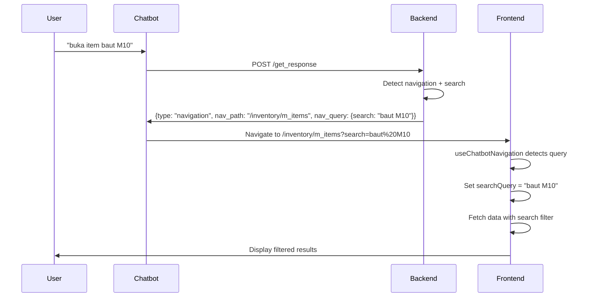

# Chatbot Navigation & Auto-Search Feature

## 📝 Overview

Fitur ini memungkinkan chatbot untuk langsung navigate ke halaman tertentu DAN auto-search data spesifik, sehingga user tidak perlu scroll  atau search manual.

## 🎯 Use Cases

### Example 1: Search Item
**User input:** "buka item baut M10"

**Flow:**
1. Chatbot detect → navigate ke halaman Items
2. Auto-search "baut M10"
3. User langsung lihat hasil tanpa scroll

### Example 2: Open Specific Customer
**User input:** "buka customer PT Jaya"

**Flow:**
1. Navigate ke halaman Customer
2. Auto-search "PT Jaya"
3. Tampilkan hasil

---

## 🔧 Implementation

### 1. Backend Chatbot Response Format

Ketika chatbot detect user mau navigate + search, backend harus return format ini:

```json
{
  "type": "navigation",
  "response": "Membuka halaman Item dan mencari: Baut M10",
  "nav_path": "/inventory/m_items",
  "nav_query": {
    "search": "baut M10",
    "id": "optional_item_id_123"
  }
}
```

#### Fields Explanation:
- `type`: **"navigation"** (wajib)
- `response`: Pesan yang ditampilkan ke user
- `nav_path`: Path halaman tujuan (contoh: `/inventory/m_items`, `/sales/m_customer`)
- `nav_query`: Object berisi query params
  - `search`: Keyword untuk auto-search
  - `id`: (Optional) ID spesifik untuk langsung buka form

### 2. Frontend Landing Page Implementation

#### Step 1: Import composable

```vue
<script setup lang="ts">
import { useChatbotNavigation } from '@/composables/useChatbotNavigation'

// Existing search query ref
const searchQuery = ref('')

// Add chatbot navigation support
useChatbotNavigation(searchQuery, () => {
  // Optional: trigger refresh data setelah search
  fetchData()
})
</script>
```

#### Step 2: That's it! 
The composable will automatically:
- Detect route query params
- Set searchQuery value
- Show toast notification
- Trigger callback if provided

---

## 📋 Complete Example

### Backend Python (Flask/FastAPI)

```python
@app.post("/get_response")
def chatbot_response(request):
    user_query = request.json.get("query")
    
    # Detect jika user mau cari item
    if "buka item" in user_query.lower() or "cari item" in user_query.lower():
        # Extract keyword (misal: "baut M10")
        keyword = extract_keyword(user_query)  # Your logic
        
        return {
            "type": "navigation",
            "response": f"Membuka halaman Item dan mencari: {keyword}",
            "nav_path": "/inventory/m_items",
            "nav_query": {
                "search": keyword
            }
        }
    
    # ... other logic
```

### Frontend Landing Page

```vue
<script setup lang="ts">
import { ref } from 'vue'
import { useChatbotNavigation } from '@/composables/useChatbotNavigation'

const searchQuery = ref('')
const menuData = ref<ItemsItem[]>([])

// Fetch data function
const fetchData = async () => {
  loading.value = true
  try {
    const response = await getItemsList({ 
      search: searchQuery.value,  // Will be auto-filled by chatbot
      page: currentPage.value,
      limit: pageSize.value
    })
    menuData.value = response.data
  } catch (error) {
    toast.error('Gagal memuat data')
  } finally {
    loading.value = false
  }
}

// Enable chatbot navigation
useChatbotNavigation(searchQuery, fetchData)

// Initial load
onMounted(fetchData)
</script>

<template>
  <div>
    <Input 
      v-model="searchQuery" 
      placeholder="Search..."
      @update:modelValue="fetchData"
    />
    <!-- Your table/list -->
  </div>
</template>
```

---

## 🎨 UX Flow



---

## 📌 Notes

### For Backend Developer (Mas Zefa):
1. Tambah logic di backend chatbot untuk detect navigation keywords
2. Return format JSON sesuai spesifikasi di atas
3. Pastikan `nav_path` sesuai dengan route yang ada di frontend

### For Frontend Developer:
1. Import dan gunakan `useChatbotNavigation` di setiap Landing page
2. Pastikan `searchQuery` ref sudah ada dan terhubung dengan input search
3. Pass callback function jika perlu trigger fetch data

### Endpoint Paths Reference:
**IMPORTANT:** Gunakan path yang PERSIS seperti ini (case-sensitive):

#### Inventory & Items
- **Items (Inventory):** `/inventory/m_items`  
- **Items (Purchasing):** `/purchasing/master/m_items`
- **Stock Opname:** `/inventory/t_stock_opname`
- **Stock Adjustment:** `/inventory/t_stock_adj`

#### Sales
- **Customer:** `/sales/m_customer`
- **Sales Order:** `/sales/t_sales_order`
- **Delivery Order:** `/sales/t_delivery_order`

#### Purchasing
- **Supplier:** `/purchasing/m_supplier`
- **Purchase Order:** `/purchasing/transaksi/t_purchase_order`
- **Purchase Request:** `/purchasing/transaksi/t_purchase_request`

⚠️ **Common Mistakes to Avoid:**
- ❌ `/master/items` (tidak terdaftar)
- ❌ `/items` (tidak terdaftar)
- ✅ `/inventory/m_items` atau `/purchasing/master/m_items`

---

## 🚀 Future Enhancements

1. **Auto-open Form by ID**
   - Backend return: `"nav_query": { "id": "123", "action": "edit" }`
   - Frontend: Langsung buka form edit dengan ID tersebut

2. **Multi-filter Support**
   ```json
   "nav_query": {
     "search": "baut",
     "category": "hardware",
     "status": "active"
   }
   ```

3. **Voice Command**
   - "Hey bot, bukakan item baut M10"
   - Auto-trigger navigation + search

---

## ✅ Checklist

- [x] Update `executeNavigation` di ChatWidget.vue
- [x] Buat composable `useChatbotNavigation`
- [x] Dokumentasi backend response format
- [ ] Implement di backend chatbot (Backend team)
- [ ] Test end-to-end flow
- [ ] Apply ke semua Landing pages

---

**Created:** March 2, 2026  
**Last updated:** March 2, 2026
